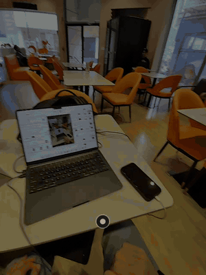
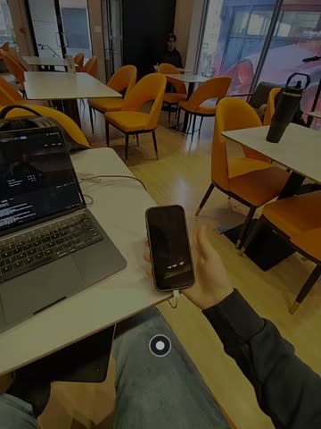
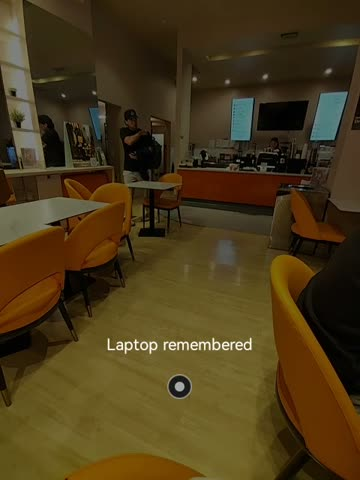
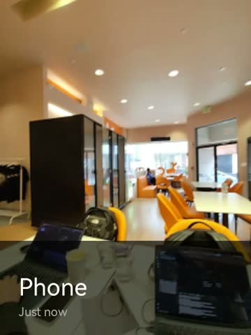
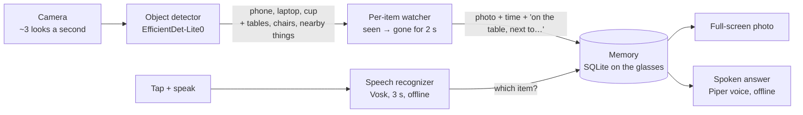

# RokidFinder

**Rokid Glasses that remember where you put things.**

The glasses' camera quietly watches for your phone, laptop and cup. When you put one down and walk away, they keep
a photo of where it was. Tap the side of the glasses, ask *"Where's my phone?"*, and they show you the photo and tell
you out loud: *"Your phone, on the dining table, next to your laptop, five minutes ago."*

Everything runs on the glasses. No phone app, cloud or internet.

[](https://github.com/Spiro-12/rokid-finder/actions/workflows/build.yml)
[](LICENSE)


<p align="center"></p>

<p align="center"><sub>A real recording from the glasses at home (sped up while walking). The display is see-through, so the camera
view is mirrored behind it for the recording. With sound on, the glasses say <i>"Your phone, on the dining table, just now."</i></sub></p>

## What it does

| You | The glasses |
|---|---|
| Put your phone on a table and walk off | Wait until it has been out of view for 2 seconds, then save a photo, the time, and what it was on or next to. A small "Phone remembered" fades in and out. |
| Tap the temple touchpad and say "Where's my phone?" | Show the photo full screen and say "Your phone, on the dining table, next to your laptop, five minutes ago." |
| Swipe while a photo is showing | Flip through everything else it remembers. Tap to close, or it closes itself after 8 seconds. |
| Ask "Find my keys" | Say "I can't see keys or wallets yet. Ask me about your phone, laptop or cup." (keys are not something the built-in model knows, see [Limits](#honest-limits)) |
| Press volume up | Record mode: mirror the camera onto the display so a screen recording shows what you saw. |

The rest of the time the display shows one dim dot and nothing else.

<p align="center">
  
  
  
</p>
<p align="center"><sub>Watching · Remembered · Asked "where's my phone?"</sub></p>

## Why I built this

*By Spiro*

I kept losing my stuff. My phone on the couch, my laptop in another room, a cup I put down somewhere and forgot about.
Every time it was the same few minutes of walking around the house looking for it.

I already had a pair of Rokid Glasses, and they have a camera that sees what I see. So I thought: **why can't they
just remember where I put things?**

It started as a passion project to help myself. Now it runs fully on the glasses, knows three everyday objects, and
answers with what I actually want in that moment: a photo of where it is and one plain sentence. I'm the only one
who has tested it so far. I'm sharing it so other Rokid owners can try it, break it, and help it find the things
everyone loses most, like keys.

## Get it on your glasses

You need Rokid Glasses (the model with the camera and display) and `adb` working with them.

1. **Download** `rokid-finder.apk` from the [latest release](https://github.com/Spiro-12/rokid-finder/releases/latest)
   (or [build it yourself](docs/setup.md#build-from-source)).
2. **Install** it:
   ```bash
   adb install -r rokid-finder.apk
   ```
3. **Give it the camera and microphone** (granting over `adb` is the reliable way on the glasses):
   ```bash
   adb shell pm grant com.example.rokidfinder android.permission.CAMERA
   adb shell pm grant com.example.rokidfinder android.permission.RECORD_AUDIO
   ```
4. **Open RokidFinder from the glasses' own app list**, not over `adb`. The first start takes a little longer while
   it unpacks its speech models; a tap during that time answers "One moment…".
5. **Try it:** put your phone on a table, look at it for a second, look away. When you see "Phone remembered",
   tap the touchpad and ask "Where's my phone?"

No cable? [awesome-rokid](https://github.com/Anezium/awesome-rokid) lists the cable-free ways to sideload.
Every step in detail: **[Setup](docs/setup.md)**.

## How it works



1. The camera runs in a background service. About three times a second, an on-device object detector
   (EfficientDet-Lite0, which knows the 80 everyday COCO object types) looks at the frame.
2. Each tracked item has its own little watcher. While the item is in view it keeps the last few good frames.
   Once the item has been gone for 2 seconds, it saves the latest frame as that item's memory.
3. From the same frame it works out context with simple box geometry: which surface the item sits *on* (table,
   couch, bed, chair, sink) and what it is *next to*. Only confident detections get mentioned, because a wrong
   "next to the book" costs more trust than a missing one.
4. A tap opens the microphone for 3 seconds. Vosk listens for a short, fixed list of phrases ("where's my phone",
   "find my cup"…), which makes it far more accurate than open dictation.
5. The answer is built from the saved fields, so the screen and the voice always say the same thing. The glasses
   have no built-in text-to-speech, so the app brings its own (a Piper voice running on sherpa-onnx).

More detail, file by file: **[How it works](docs/how-it-works.md)**.
Building your own Rokid app? The device quirks this project hit are in **[Notes for Rokid builders](docs/rokid-notes.md)**.

## Honest limits

- **Three items:** phone, laptop and cup. The detector only knows COCO object types, and keys and wallets are not
  one. Teaching it keys needs a custom model ([how you could](docs/make-it-yours.md#keys-wallets-and-other-things-coco-doesnt-know)).
- **It remembers the last place only.** One photo per item; a newer sighting replaces the older one.
- **It has to see the item go.** If the item was never clearly in view (at least 40% sure), nothing is saved.
- **Tested by one person** (Spiro), at home and in a café, over a few months of building. No accuracy numbers yet,
  and battery life has not been measured.
- **English only**, and only the phrases in its list.

## Privacy

- **Nothing leaves the glasses.** No account, no cloud, no analytics. The default build never opens a network
  connection (an experimental Mac link exists in the code but is switched off; see [Privacy](docs/privacy.md)).
- **The camera watches from the moment you open the app until you force-stop it** (it keeps going in the background,
  with a "RokidFinder watching" notification). Frames are looked at in memory and thrown away. Only one photo per
  item is kept, in the app's private storage.
- **The microphone is only on for 3 seconds after you tap.** Audio is never saved.
- **Other people:** the saved photos can include people around you. Nothing recognizes faces, but be considerate,
  and remember the glasses are a camera.

To erase everything, uninstall the app or clear its data. Details: **[Privacy](docs/privacy.md)**.

## FAQ

<details>
<summary><b>Which glasses does it run on?</b></summary>

Rokid Glasses with the camera and display (YodaOS, Android 12, arm64). It is a normal Android app, so it may run on
other arm64 Android glasses or phones, but the touchpad, camera rotation and microphone handling are tuned for Rokid.

</details>

<details>
<summary><b>Does it need my phone, the Rokid app, or Wi-Fi?</b></summary>

No. Detection, memory, speech recognition and the voice all run on the glasses.

</details>

<details>
<summary><b>Why can't it find my keys?</b></summary>

The built-in detector was trained on the COCO dataset, which has phones, laptops and cups but no keys or wallets.
Adding them means training a small custom model. That is the most wanted contribution:
[Make it yours](docs/make-it-yours.md).

</details>

<details>
<summary><b>How do I record a demo like the one above?</b></summary>

Open the app on the glasses, then run `./record-demo.sh` on a computer with `adb` and `scrcpy`. It turns record
mode on and off for you. See [Recording a demo](docs/recording-a-demo.md).

</details>

<details>
<summary><b>Why is the APK so big (about 130 MB)?</b></summary>

It carries three offline models: the speech recognizer (~70 MB), the voice (~37 MB with its data) and the object
detector (~5 MB), plus the ONNX runtime. That is the price of working with no internet.

</details>

More: **[Troubleshooting](docs/troubleshooting.md)**.

## Docs

| Guide | What is in it |
|---|---|
| [Setup](docs/setup.md) | Install, permissions, first run, build from source |
| [How it works](docs/how-it-works.md) | The pipeline, every threshold, and a map of the code |
| [Notes for Rokid builders](docs/rokid-notes.md) | Device quirks: no TTS, camera rotation, microphone, touchpad, Wi-Fi |
| [Make it yours](docs/make-it-yours.md) | Track different objects, change timings, teach it keys |
| [Recording a demo](docs/recording-a-demo.md) | Record mode and screen recording |
| [Privacy](docs/privacy.md) | What is stored, where, and for how long |
| [Troubleshooting](docs/troubleshooting.md) | When something does not work |
| [Contributing](CONTRIBUTING.md) | Building, testing on glasses, pull requests |

## Contributing

Ideas, bug reports and pull requests are welcome, especially:

- **Keys and wallets:** a small custom detector the app can load next to EfficientDet.
- **More phrases and languages** for the speech recognizer.
- **Your results:** if you try it on your glasses, [tell us how it went](https://github.com/Spiro-12/rokid-finder/issues/new/choose).

See [CONTRIBUTING.md](CONTRIBUTING.md).

## Credits

- Built by Spiro El Khoury, with Claude Code as the coding partner.
- Object detection: [EfficientDet-Lite0](https://www.tensorflow.org/lite/models/modify/model_maker/object_detection)
  via the [TensorFlow Lite Task Library](https://www.tensorflow.org/lite/inference_with_metadata/task_library/object_detector) (Apache 2.0).
- Speech recognition: [Vosk](https://alphacephei.com/vosk/) and its small US English model (Apache 2.0).
- Voice: the [Piper](https://github.com/rhasspy/piper) `en_US-amy-low` voice
  ([model card and license](https://huggingface.co/rhasspy/piper-voices/tree/main/en/en_US/amy/low)), run with
  [sherpa-onnx](https://github.com/k2-fsa/sherpa-onnx) (Apache 2.0) and [ONNX Runtime](https://onnxruntime.ai/) (MIT).
- Pronunciation: [espeak-ng](https://github.com/espeak-ng/espeak-ng) and its data (GPL-3.0), used by the Piper voice.
- Networking and native glue: [OkHttp](https://square.github.io/okhttp/) and [JNA](https://github.com/java-native-access/jna) (Apache 2.0).
- Camera: [CameraX](https://developer.android.com/media/camera/camerax).
- The Rokid community catalog [awesome-rokid](https://github.com/Anezium/awesome-rokid).

## License

[MIT](LICENSE) for the code in this repo. The bundled models and libraries keep their own licenses (above). Because
the voice uses espeak-ng (GPL-3.0), the APK as a whole is also covered by the GPL-3.0; its full source is this repo.
