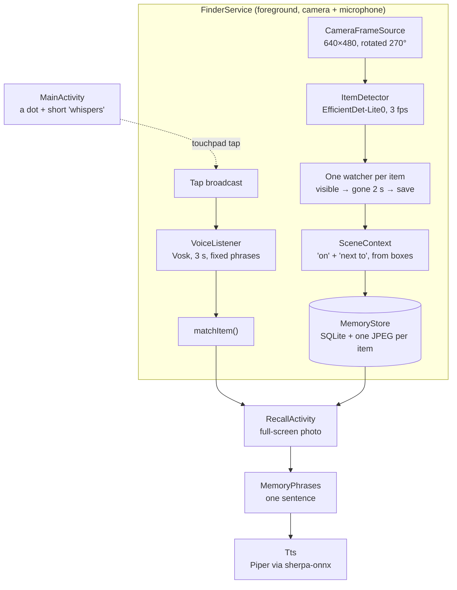

# How it works

RokidFinder is one Android app with one background service. Everything below runs on the glasses.

## 1. Watching

`CameraFrameSource` binds CameraX `ImageAnalysis` to the service at 640×480, converts each YUV frame to an upright
bitmap (a fixed 270° turn, because the sensor's reported rotation is wrong on these glasses), and hands it on.

`FinderService` runs detection on at most **3 frames a second** (`TARGET_FPS`) and drops the rest. That keeps the
glasses cool and leaves CPU for speech.

`ItemDetector` runs **EfficientDet-Lite0** (COCO, via the TFLite Task Library, 2 threads) and keeps two kinds of
results:

- **Tracked items:** `cell phone`, `laptop`, `cup` (`TrackedItems.kt`).
- **Context objects:** surfaces (`dining table`, `couch`, `bed`, `chair`, `sink`) and good "next to" anchors
  (`tv`, `keyboard`, `mouse`, `book`, `bottle`, `refrigerator`, `backpack`, `handbag`).

The model runs with a 0.35 floor so context objects can ride along; tracked items must reach **0.40** to count as
"in view".

## 2. Deciding something was put down

Each tracked item has its own small state machine in `FinderService`:

| State | What happens |
|---|---|
| In view (≥ 0.40) | Remember the time and keep a copy of the frame plus all its detections. Only the last **3** good frames are kept. |
| Out of view, less than **2 s** | Nothing yet. A missed frame or a turn of the head is not a "put down". |
| Out of view for **2 s** | Save the newest kept frame as this item's memory. Clear the buffer. |
| Saved less than **15 s** ago | Skip the save (stops one item flickering in and out from writing over and over). |

The saved photo is the last good look at the item, which is usually the moment you set it down and turned away.

## 3. Context: "on the table, next to your laptop"

`SceneContext.derive()` uses the detections from **the same frame as the photo**, so the words always match the
picture. Pure box geometry, no extra model:

- **On:** a surface whose box contains the item's horizontal center, with the item's bottom edge inside the surface
  box (a little slack above the top edge, because a cup often hides the table's rim). The largest such surface wins.
- **Next to:** up to two objects whose centers are within 1.5 item-widths. Other tracked items come first
  ("your laptop" beats "the book").
- Only detections at **0.45** or more are ever spoken about. A wrong "next to the book" costs more trust than a
  missing one.

## 4. Memory

`MemoryStore` is one SQLite table, **one row per item**. A new sighting replaces the old one.

| Column | Example |
|---|---|
| `item` | `phone` |
| `kind` | `everyday` |
| `surface` | `dining table` |
| `near` | `["laptop","book"]` (JSON) |
| `place` | always empty for now (a slot for a future room or place classifier) |
| `snapshot` | path to `phone.jpg` in the app's private files |
| `ts`, `confidence` | when, and how sure |

Sentences are never stored. They are built when needed from these fields, so the wording can change without old
memories going stale.

## 5. Asking

A tap on the temple touchpad arrives in `MainActivity` as a key event. It sends a broadcast to the service (and
ignores taps for 3.5 s so one tap cannot start two queries).

`VoiceListener` opens the microphone for **3 seconds**, 16 kHz mono, and runs **Vosk** with a fixed grammar: the
phrases "where is my …", "where's my …", "find my …", "my …" and the bare item name, for phone, laptop, cup, keys and
wallet, plus `[unk]` so noise does not get forced into a phrase. A small grammar makes short commands far more
accurate than free dictation.

`matchItem()` then looks for an item name in the text:

| Heard | Result |
|---|---|
| phone, laptop or cup | Open the photo for that item and speak the answer. |
| keys or wallet | Say "I can't see keys or wallets yet…" (the on-device model has no such class). |
| nothing useful | Whisper "Didn't catch that". |

## 6. Answering

`RecallActivity` shows the memory's photo full screen with the item name and a caption ("On the dining table · 5
minutes ago"). Swiping flips through the other memories. A tap closes it, and it closes itself after 8 seconds.

`MemoryPhrases` builds both the caption and the spoken sentence from the same fields and the same time buckets
("just now", "five minutes ago", "yesterday"), so eyes and ears always agree. Numbers are spelled out because the
voice reads words better than digits.

`Tts` speaks it with a **Piper** voice (`en_US-amy-low`, int8) through **sherpa-onnx**. YodaOS has no system
text-to-speech engine, so the app brings its own. Audio streams into an `AudioTrack` while it is generated, so
speech starts quickly.

## 7. The display

The display is see-through and monochrome, so the app draws almost nothing:

- a dim **dot** while watching (it pulses while listening),
- short **whispers** that fade out: "Phone remembered", "Didn't catch that", "One moment…",
- the full-screen **photo** when answering.

Volume up toggles **record mode**, which mirrors the camera onto the display so a screen recording shows the scene
behind the overlay ([Recording a demo](recording-a-demo.md)).

## What's in the APK

| Part | Size (about) | Used for |
|---|---|---|
| Vosk `model-en-us` | 70 MB | Offline speech recognition |
| ONNX Runtime + sherpa-onnx (`jniLibs/arm64-v8a`) | 35 MB | Running the voice |
| Piper `en_US-amy-low` + `espeak-ng-data` | 37 MB | The voice |
| `efficientdet_lite0.tflite` | 4.5 MB | Object detection |

The APK is built for **arm64 only** (`abiFilters`), which is what the glasses use.

## Code map

| File | What it does |
|---|---|
| `MainActivity.kt` | The watching screen: dot, whispers, touchpad, permissions, record mode |
| `FinderService.kt` | Foreground service: camera loop, per-item watchers, voice requests |
| `CameraFrameSource.kt` | CameraX → upright bitmaps |
| `ItemDetector.kt` | EfficientDet-Lite0 wrapper and the context label lists |
| `TrackedItems.kt` | The items it tracks (change this to track others) |
| `SceneContext.kt` | "On" and "next to" from bounding boxes |
| `MemoryStore.kt` | SQLite rows and JPEG snapshots |
| `MemoryPhrases.kt` | Captions and spoken sentences |
| `VoiceListener.kt` | Vosk, microphone, phrase grammar |
| `RecallActivity.kt` | Full-screen photo answer and swipe-through |
| `Tts.kt`, `com/k2fsa/sherpa/onnx/Tts.kt` | Piper voice via sherpa-onnx |
| `FramePreview.kt` | Hands camera frames to the display in record mode |
| `LinkClient.kt`, `Discovery.kt`, `FrameUplink.kt`, `AudioStreamer.kt`, `SpeakQueue.kt` | Experimental Mac link, **off by default** (see [Privacy](privacy.md#the-experimental-mac-link)) |
